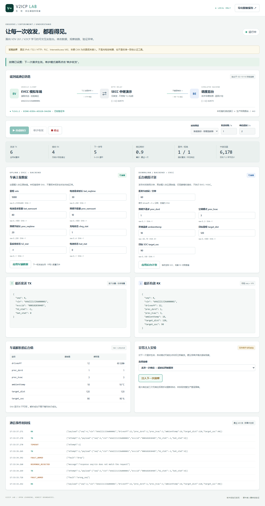

# V2ICP Lab

**把车、桩和后台之间的通信，变成能看见、能修改、能复现的实验。**

[English](README.en.md) · [快速上手](docs/quickstart.md) · [通信原理](docs/learning-guide.md) · [硬件接入](hardware/README.md) · [路线图](docs/roadmap.md)

V2ICP Lab 是一个面向 VDV 261 / V2ICP 学习和集成开发的本地实验室。项目将 EVCC 客户端、字节中继和模拟调度后台放在一台电脑中运行，使用真实的 IPv6、TLS 和 HTTP 通信，再通过浏览器展示双向数据。

它适合用来理解通信流程、验证应用层处理、讨论软硬件接口，**不用于实际充电控制，也不宣称通过标准一致性认证**。



## 开始使用

环境要求：Python 3.10+、可在命令行调用的 OpenSSL，以及可用的 IPv6 回环。运行时仅使用 Python 标准库，不需要 npm、前端构建或 CDN。

在项目根目录执行：

```powershell
python -m demo.web --open
```

界面默认位于 `http://127.0.0.1:8765/`。Windows 下也可双击 `start-lab.cmd`。终端需保持运行；退出时先停止会话，再按 `Ctrl+C`。

命令行模式：

```powershell
python -m demo.run_demo --interval 1 --cycles 4
```

遇到环境、证书或端口问题，先看[快速上手与排错](docs/quickstart.md)。

## 可以做什么

- 自动运行或逐帧收发，查看 TLS 状态、序号、延迟和中继流量。
- 修改车辆状态、目标 SOC 和发车计划，观察下一轮报文变化。
- 对比首次全量与后续增量，以及协议原始值与解析后的值。
- 注入丢响应、错误序号、错误 VIN、HTTP 503 和超长响应。
- 查看最近 400 条事件，导出脱敏 JSON 报告。

建议从这个小实验开始：点击“自动运行”，把后台 `target_soc` 改为 `90` 并应用，观察 RX；停止后切换到“单步收发”，注入错误序号，再看拒绝计数和最后一次有效响应。

默认 `1s / 2s` 是加速演示时序。参考 `10s / 15s` 预设也不代表已覆盖规范全部时序和恢复要求。

## 通信结构

```text
浏览器 ── 本机控制 API
                 │
          EVCC 模拟客户端
                 │
                 └── TLS / HTTP over IPv6 ── 字节中继 ── 模拟后台
```

TLS 在模拟 EVCC 与后台之间建立，中继只转发加密字节，不持有后台私钥。界面的本机 HTTP 服务与实验中的 TLS 通道是两回事。

迁到真机时，V2ICP 数据连接应独立于原 ISO 15118 充电连接：各自持有 socket、TLS、缓冲和超时状态。**InternetAccess 不表示关闭原充电连接。** 本仓库的固定目的字节中继不等于 InternetAccess VAS 或生产 IPv6 路由器。详见[集成设计](docs/hardware-integration.md)。

## 项目范围

| 已提供 | 尚未提供 |
|---|---|
| 本地仪表盘、模拟车端和后台、真实回环网络 | PLC / SLAC、InternetAccess VAS 和真实网关适配 |
| 协议模型、异常处理及自动测试 | 独立的条款级规范复核和一致性认证 |
| 参考硬件架构、BOM、接口核对表和验证模板 | 定版原理图、PCB、Gerber 或可刷写生产固件 |
| 纯 C 目标接纳边界与主机示例 | 车辆 CAN、VCU / BMS / HVAC 执行和整车测试 |

硬件资料属于**接入参考**，并非可制造硬件设计；没有上板验证。信号取值记录的是当前实现，使用前应对照合法获得的目标版本规范检查单位、枚举、时序和必选条件。完整限制见[依据与限制](docs/sources-and-limitations.md)。

## 文档索引

| 内容 | 入口 |
|---|---|
| 操作与实验 | [快速上手](docs/quickstart.md)、[五个通信实验](docs/learning-guide.md) |
| 代码与数据 | [软件架构/API](docs/architecture.md)、[信号字典](docs/signals.md) |
| 嵌入式集成 | [EVCC/SECC 接入设计](docs/hardware-integration.md)、[C 接口示例](embedded/README.md) |
| 硬件资料 | [硬件入口](hardware/README.md)、[BOM](hardware/bom.csv)、[接口表](hardware/interfaces.csv) |
| 验证方法 | [测试说明](docs/testing.md)、[验证记录](docs/validation-record.md)、[上板清单](hardware/validation-checklist.md) |
| 维护与发布 | [贡献指南](CONTRIBUTING.md)、[安全政策](SECURITY.md)、[版本发布](docs/github-release.md)、[更新记录](CHANGELOG.md) |

## 开发

```powershell
python -m unittest discover -s tests -v
python tools/release_check.py
```

浏览器验收和 C 主机测试见[测试说明](docs/testing.md)。目录划分：`demo/` 为运行软件，`tests/` 为测试，`embedded/` 为 C 参考接口，`hardware/` 为硬件资料，`docs/` 为项目文档。

## 安全与许可

UI 仅绑定本机回环，不应暴露到公网。`.demo_certs/` 和 `output/` 不纳入版本控制；CLI 原始报告未脱敏，分享前需检查。公开示例身份与密码不能用于生产。后台目标只有经过整车本地策略检查后才有资格进入执行流程，解析成功不等于执行成功。

原创代码、文档与示意图使用 [MIT 许可](LICENSE)。项目不包含 VDV/ISO 标准全文、私人固件、厂商图纸或私有 DBC；第三方权利见 [NOTICE](NOTICE.md)。欢迎提交可复现问题、匿名测试与有依据的适配改进。
