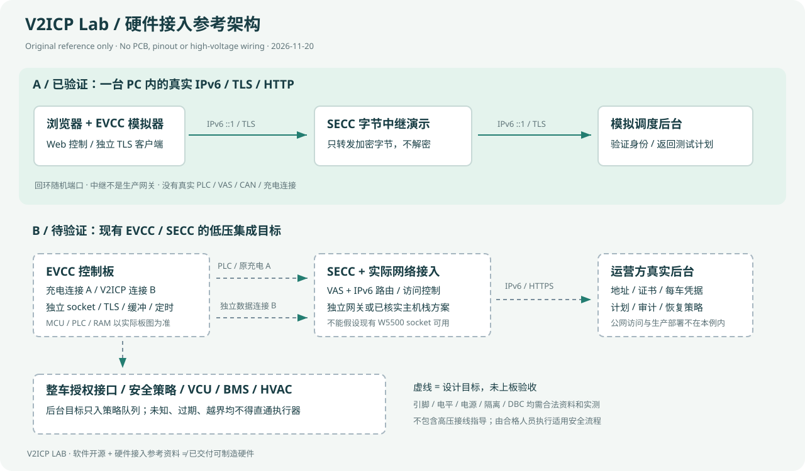

# 硬件接入资料 · 参考级，不是成品板卡

## 交付定位

这一目录提供**原创系统架构、器件类别BOM、接口核对表、上板步骤和验收记录模板**。它能帮助你规划如何把软件实验迁到已有控制板，但没有原理图、PCB、Gerber或实际板卡测量。所有标为 TBD 的项目都必须由实际硬件资料确认后填写，不得猜引脚。

## 两套使用方式

### A. 仅PC学习，今天即可复现

- 一台支持IPv6回环的Windows/Linux电脑。
- Python 3.10+、OpenSSL和浏览器。
- 不需要真实PLC模块、CAN适配器、车辆、电池或充电桩；不接高压。

### B. 真机迁移，需要额外工程工作

| 角色 | 必需能力 | 交付中是否已有驱动/验证 |
|---|---|---|
| EVCC | 与PLC关联的网络栈、额外TCP/TLS上下文、证书/凭据存储、时间源、整车接口 | 否；提供设计和C边界示例 |
| SECC | 原充电状态机、InternetAccess VAS及实际IPv6接入/路由/访问策略 | 否；本机字节中继不能替代 |
| 后台 | EVCC可达的IPv6/域名、HTTPS、每车凭据、调度数据和审计 | 仅有本机模拟后台 |
| 整车侧 | 经授权的CAN/VCU/BMS/HVAC接口和独立安全控制 | 否；无真实DBC/执行器 |
| 调试侧 | 按板卡选用SWD/UART、隔离CAN/网络抓包和低压电源 | BOM给类别，不预设具体引脚 |

板卡兼容性需要逐项验证：MCU、PLC模块、网络接口、RTOS与TLS库版本都应写入测试记录。此项目不依赖特定私人固件，也不把某个工程配置文件当作实物兼容证据。

## 文件怎么用

1. 用 `bom.csv` 区分“仅PC必需”和“低压上板可选”，先明确已有硬件再选型，不盲目采购。
2. 在 `interfaces.csv` 中填写实际连接器/引脚、信号电平、电源方向、隔离和证据来源。
3. 阅读 `../docs/hardware-integration.md`，先解决真实IPv6路径和双连接上下文，不能只加一个后台IP宏。
4. 按 `validation-checklist.md` 从低压断开的台架逐步推进。
5. 复制 `bringup-record-template.md` 到本地 `output/`，记录原始结果；匿名整理后再提交公开证据。

## 不可省略的约束

- QCA7000等模块的SPI/UART、主从角色、时钟模式、复位/中断和电压必须按实际模块与原理图核对；不同模块不能照抄引脚。
- 不能把W5500的现有IPv4 socket代码直接当作已完成的IPv6路由。需要核实使用模式、主机栈、MTU、NDP/RA和真实转发路径；也可选择独立IPv6网关，选择依据由实测决定。
- 不将调度目标直接驱动功率级；不让后台连接阻塞原充电任务；未知安全状态不能强行置“正常”。
- 上板资料仅覆盖隔离、受控、低压开发台架。高压、接触器、绝缘监测、CP/PE耦合等设计与测试应由有资质人员依据适用法规和厂商资料执行，本项目不提供带电接线步骤。

## 何时才能叫完整开源硬件？

需要自行拥有或合法获授权的原理图/PCB源文件、可复现BOM与版本、制造输出、装配/调试说明、许可与变更记录，再加真实验证。本项目当前是**软件开源 + 硬件接入参考文档**，不宣称已经交付可制造开源硬件或取得硬件认证。
